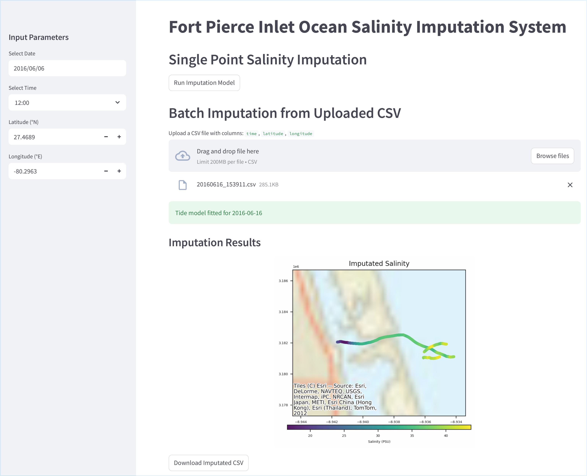

# 🌊 OASIS: Ocean Salinity Imputation System

> 📝 This repository accompanies the paper:  
> **"OASIS: Harnessing Diffusion Adversarial Network for Ocean Salinity Imputation using Sparse Drifter Trajectories"**  
> *(Accept by CIKM 2025)*
> [arXiv](https://arxiv.org/abs/2508.21570)
> [ACM](https://dl.acm.org/doi/pdf/10.1145/3746252.3761541)
> 
**OASIS** is a web-based system for reconstructing sparse ocean salinity. It is designed for offshore and coastal scenarios where drifter data is sparse, noisy, or irregular. Powered by an adversarial diffusion framework, OASIS supports on-demand interactive and batch-mode salinity imputation with integrated access to NOAA tide data.

🌐 Live Demo:
[https://fpoasis.streamlit.app/](https://fpoasis.streamlit.app/)



## 🎯 Key Features

- ✅ On-demand Ocean Salinity imputation using Adversarial Diffusion Network model
- 📂 Support for single-point and multi-point (CSV) batch input
- 🌊 Integrated tide data retrieval from NOAA CO-OPS API
- 🧠 Transformer + Adversarial Diffusion model backend with tidal conditioning
- 🗺️ Geospatial map visualization and salinity trajectory display

## 📊 Example Usage
- 🌐 Query salinity at Fort Pierce Inlet for a given time and location
- 📂 Upload a CSV file with time, latitude, and longitude columns ([Download Sample CSV](./data/20160616.csv))
- 🗺️ Visualize salinity values on a color map with drift trajectories

## 🧠 Model
The model imputes salinity based on:
- 📅 Temporal features: hour, minute, day, month (sin/cos encoded)
- 📍 Spatial coordinates: latitude, longitude
- 🌊 Auxiliary covariate: tide level (fitted via NOAA data)

## 📃 License
MIT License.

## 📖 Citation

If you find OASIS useful in your research, please cite our paper:

```bibtex
@inproceedings{li2025oasis,
  title     = {{OASIS}: Harnessing Diffusion Adversarial Network for Ocean Salinity Imputation using Sparse Drifter Trajectories},
  author    = {Li, Bo and Feng, Yingqi and Jin, Ming and Zheng, Xin and Tang, Yufei and Cherubin, Laurent and Liew, Alan Wee-Chung and Wang, Can and Lu, Qinghua and Yao, Jingwei and Pan, Shirui and Zhang, Hong and Zhu, Xingquan},
  booktitle = {Proceedings of the 34th ACM International Conference on Information and Knowledge Management (CIKM '25)},
  pages     = {5822--5830},
  year      = {2025},
  publisher = {ACM},
  doi       = {10.1145/3746252.3761541}
}
```
